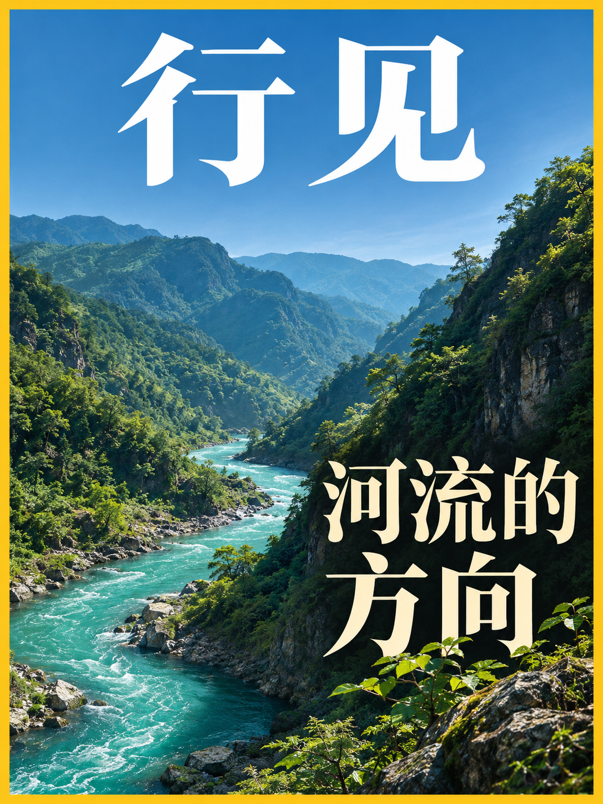
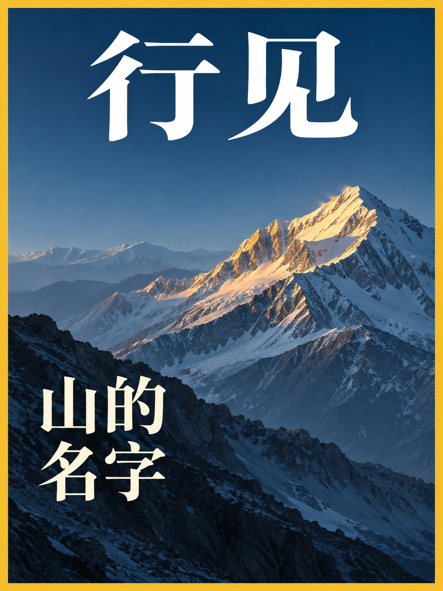

# 旅图编辑 · Travelogue Editor

**把旅行照片编成有故事、有图解、有跨页设计的地理人文杂志。**

从相册里寻找主题，完成选片、研究、文案、原创封面与排版，输出可阅读的 PDF 和可继续修改的源文件。

[English](README.en.md) · [使用指南](docs/usage.md) · [下载发布包](https://github.com/StuPeter/travelogue-editor/releases/latest) · [更新记录](CHANGELOG.md)

<p>




</p>

以上为随包提供的 AI 原创摄影感艺术示例，不对应具体真实地点。“行见”是示例杂志刊名；旅图编辑是项目名称。新一期根据用户素材重新确定刊名与主题。

## 能做什么

- **编辑策划**：从照片、经历和研究中寻找故事，规划整刊阅读路线与跨页节奏。
- **封面艺术指导**：根据实际素材选择主视觉、展示字体、自然字场与图文层次。
- **知识图解**：为建筑、自然、工艺等题材策划有资料依据的解释性插画与标注。
- **旅行日志**：把风景、人物、沿途片段组织为地理人文与旅途叙事。
- **排版输出**：焦点裁切、异形图片窗口、可编辑文字、错位引文框、导航，以及单页版与对页版 PDF。

这是一套供 AI 助手使用的 **Skill 与排版工具**。使用过程需要助手读取本地照片、开展研究并执行制作程序；封面图文融合可调用助手当前可用的图像生成工具。

## 开始使用

### 方式一：下载已打包的 Skill

从 [Releases](https://github.com/StuPeter/travelogue-editor/releases) 选择适合的版本：

| 文件 | 适用场景 |
|---|---|
| `travelogue-editor-v*.zip` | 完整版：包含字体源与两个 Skill，解压后安装 Skill 目录 |
| `travelogue-editor-platform-lite-v*.zip` | 平台轻量版：ZIP 根目录含 `SKILL.md`，适合压缩包 10 MB 以内的平台 |
| `photo-magazine-cover-v*.zip` | 单独使用封面 Skill |

轻量版首次准备字体时需要联网下载并校验约48 MB的固定版本发布包，之后复用缓存；图像生成工具由运行环境提供。完整版本内含字体源。

| Skill ID | 用途 |
|---|---|
| `photo-story-magazine` | 整刊策划、写作、图解与 PDF 制作 |
| `photo-magazine-cover` | 单独设计杂志封面 |

主 Skill 发布包内嵌封面资源，可单独安装；独立封面也有自己的下载包。Python 排版依赖与安装方式见[使用指南](docs/usage.md)。

### 方式二：从仓库安装到本地

```sh
git clone https://github.com/StuPeter/travelogue-editor.git
cd travelogue-editor
python scripts/install_local.py
```

安装脚本默认使用 `CODEX_HOME/skills`，未设置时使用 `~/.codex/skills`；可用 `--skills-dir` 指定其他目录。更新前会备份原目录。排版工具需要 Python 3.11+ 和 [requirements.txt](requirements.txt) 中的依赖。

给助手的请求示例：

```text
使用 $photo-story-magazine，把我的旅行照片做成一期杂志。
先看完整相册，给我全刊设计方案、封面和一个代表跨页样张。
我喜欢建筑与地理人文内容；其他设计由你负责。
```

## 包内有什么

- 两个可独立调用的 Skill，保留稳定的 Skill ID。
- JSON 驱动的 PDF 排版程序，以及固定字体角色与字重配置。
- 三份开源字体源、许可证、来源与哈希记录。
- 四张成品级封面示例、完整艺术指导配方和提示词。
- 十页原创组件教学样册、图片与可重建的 JSON 源文件。
- 摄影叙事、专题写作、字体、地域文字、图解策划与设计研究。

封面的[成品参考](skills/photo-magazine-cover/references/visual-examples.md)与排版的[组件教学](skills/photo-story-magazine/references/visual-specimens.md)承担不同作用。首次制作先实际渲染本期封面和代表跨页，再扩展全刊。

## 工具与验证范围

Python 排版程序可在没有图像生成工具时使用；摄影排字和可编辑蒙版仍可完成封面。生成式图文融合需要当前助手具备相应图像工具。复杂文字塑形、实拍图像上的局部对比和最终印刷规格需要另行检查。

自动检查覆盖配方、字形覆盖、文字溢出、已声明纯色字场的对比、PDF 拆页、字体嵌入、打包和安装备份。示例经过实际视觉查看；独立模型完整执行 Skill 的审美迁移评估仍需持续开展。

## 开发与更新

```sh
python -m pip install -r requirements-dev.txt
python scripts/check.py --test
python scripts/build_release.py --out dist
```

两个 `skills/` 目录各维护一份源文件，打包时自动生成嵌套封面资源。后续更新、Git 提交和发布均在本仓库管理。详见[开发说明](docs/development.md)。

## 许可

项目原创代码与文档采用 [MIT](LICENSE)。字体保留各自的 OFL 许可；AI 示例属性和材料范围见 [第三方与来源说明](THIRD_PARTY_NOTICES.md)。
